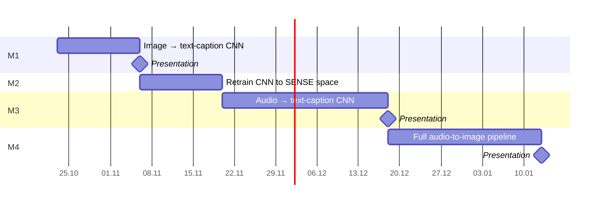

## Timeline



## Setup

```shell
python3 -m venv .venv
source .venv/bin/activate
pip install -r requirements.txt
```

## Data

Run all commands from the repository root. Skip downloading and metadata preparation when the dataset is already ready.

```shell
python3 data_processing/download_raw_dataset.py  # images and audio into data/raw/
python3 data_processing/generate_metadata.py     # data/{train,val}_meta.csv
```

## Run

```shell
source .venv/bin/activate
python3 training/train_image_to_caption.py
python3 retrieval/search_images_by_caption.py
python3 tools/debugging.py
```

To print the image CNN architecture, run `python3 models/image_cnn.py`.

## Code layout

```text
common.py                         Shared settings, paths, and helpers
models/
    image_cnn.py                  Complete image CNN definition
    caption_text_encoder.py       Complete caption encoder definition
data_processing/
    caption_data.py               Vocabulary, dataset, and image transforms
    download_raw_dataset.py       Dataset downloader
    generate_metadata.py          Metadata preparation
training/
    train_image_to_caption.py     Training, validation, and checkpoint resume
retrieval/
    caption_retrieval.py          Model loading and image embedding cache
    search_images_by_caption.py   Caption search interface
tools/
    debugging.py                  Diagnostic plots and confusion matrix
```

Dataset files remain in `data/`, and model checkpoints remain in `results/`.
