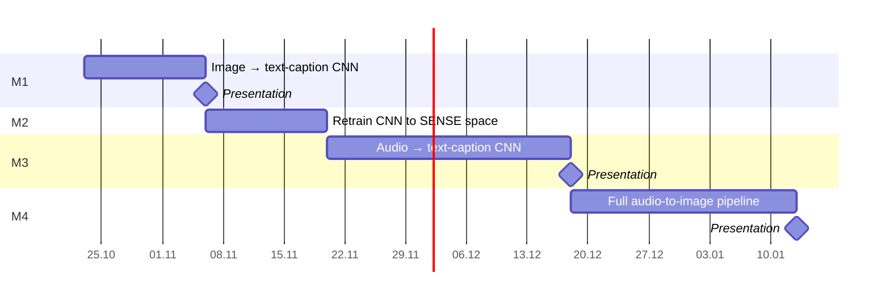

# Awesome Speech-to-Image

**Goal:** describe a photo out loud, and the program finds it.

**Idea:** turn photos and spoken captions into vectors in the same space. A photo and a caption that describe the same thing should get similar vectors. To find a photo, the search looks for the photo vector closest to the caption's vector.

The space is defined by the text embeddings of the captions from [BGE-M3](https://huggingface.co/BAAI/bge-m3), a pretrained text model.

Right now the repository contains the **photo part**: a CNN that turns a photo into such a vector. The speech part comes in M3.

## Timeline



## Setup

```shell
python3 -m venv .venv
source .venv/bin/activate
pip install -r requirements.txt
```

Run all commands from the repository root.

## Data

The data is a part of [SpokenCOCO](https://groups.csail.mit.edu/sls/downloads/placesaudio/). It contains COCO photos, and each photo has about 5 spoken captions.

| Split | Photos | Captions |
|---|---|---|
| train | 22,047 | 110,000 |
| val | 2,011 | 10,000 |

The caption lists are in Git (`data/train_meta.csv`, `data/val_meta.csv`). The photos and audio files are not, because they are too large. Download them once:

```shell
python3 -m dataset.download_raw_dataset
```

Then prepare the training data. This resizes the photos and computes the caption vectors:

```shell
python3 -m dataset.cache_images
python3 -m dataset.extract_caption_features
```

## The model

- A ResNet-18-style CNN ([models/image_cnn.py](models/image_cnn.py)), trained from scratch.
- Input: a 224 × 224 photo. Output: a vector with 1024 numbers, the same size as a BGE-M3 caption vector.
- Training: in each batch, a photo should be closer to its own captions than to the other captions in the batch (contrastive loss).
- 22,000 photos is not much for training from scratch, so the model uses a lot of data augmentation and regularization to avoid overfitting.

All settings are in [train/config.py](train/config.py).

## Results

For each val caption, the model ranks all 2,011 val photos. **R@10 = 59 %** means: for 59 % of the captions, the correct photo is in the top 10.

| | R@1 | R@5 | R@10 |
|---|---|---|---|
| caption → photo | 17.9 % | 44.3 % | 59.3 % |
| photo → caption | 21.2 % | 47.3 % | 60.9 % |
| caption → photo, improved search | 20.6 % | 48.6 % | 63.7 % |

"Improved search" uses the same model with two small tricks at search time. It looks at several crops of each photo. It also gives less weight to photos that match almost every caption.

## How to use it

Train the model (about 2 hours on a GPU; the result goes to `results/image_cnn/`):

```shell
python3 -m train.train_image_to_caption
```

Search photos by typing a caption:

```shell
python3 -m demo.search_images_by_caption
```

Evaluate the model (recall, plots and examples; saved in `results/image_cnn/evaluation/`):

```shell
python3 -m evaluate.report
```

## Folders

```
data/        caption lists; photos and audio are downloaded here
dataset/     download and prepare the data
models/      the CNN
train/       training
evaluate/    evaluation and plots
demo/        the search window
results/     trained models (not in Git)
```
