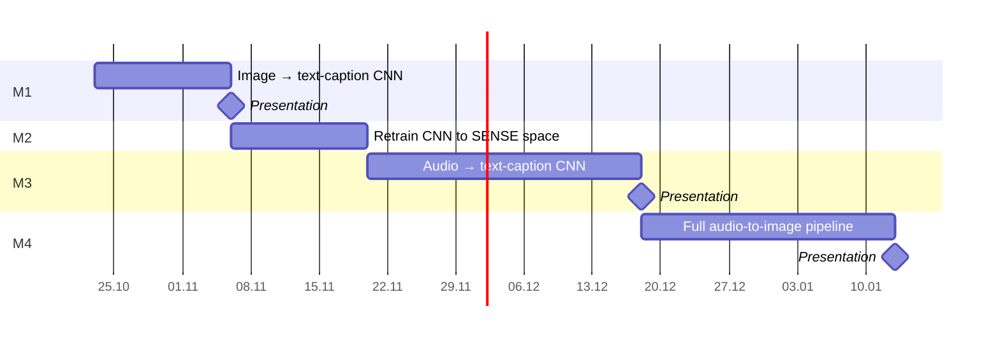

## Timeline



## Setup

```shell
python3 -m venv .venv
source .venv/bin/activate
pip install -r requirements.txt
```

## Data

Run all commands from the repository root. Skip a step when its output already exists.

```shell
python3 data_processing/download_raw_dataset.py       # images and audio into data/raw/
python3 data_processing/generate_metadata.py          # data/{train,val}_meta.csv
python3 data_processing/cache_images.py               # resized images -> data/features/{split}_images_224.npy
python3 data_processing/extract_caption_features.py   # BGE-M3 caption vectors -> data/features/{split}_text.npy
python3 data_processing/reduce_caption_features.py    # PCA to 256 numbers -> data/features/{split}_text_256.npy
```

The split has 22,047 train and 2,011 val images, with about 5 captions each (110,000 and 10,000). Row i of `{split}_text.npy` and of `{split}_text_256.npy` is row i of `{split}_meta.csv`, so it is also the caption of audio file i. The vectors are centred with the train mean, saved as `caption_mean.npy`, then reduced with a PCA fitted on the train captions, saved as `caption_pca_256.npy`. Run the reduction again whenever the BGE-M3 vectors are extracted again, and then retrain.

## The model

- The caption space is defined by [BGE-M3](https://huggingface.co/BAAI/bge-m3), a pretrained text model that is never trained here. Every caption is encoded once into a 1024-number vector, which a fixed PCA reduces to 256 numbers. Images and captions share this 256-number latent space.
- The image CNN (`models/image_cnn.py`, four blocks of convolution, batch normalisation, ReLU and max pooling, then average pooling and one linear layer; 455,168 parameters) is trained from scratch to map a 128 x 128 image to a vector in that space. Images stay cached at 224 x 224: training crops from them, and evaluation and search scale the whole image down. `DILATIONS` in `models/image_cnn.py` sets how far the filters of blocks 3 and 4 reach without adding parameters: each final feature sees 46 x 46 pixels with `(1, 1)` and 86 x 86 with `(2, 3)`. It is saved with the model, so search and evaluation always use the model's own value.
- Loss: in each batch, every caption must pick its own image out of the batch's images (cross-entropy over cosine similarities divided by a learned temperature). A batch holds 256 images with all of their captions. Only the caption-to-image direction is trained. Optional soft targets (`SOFT_TARGET_WEIGHT`, off by default) give other images in the batch part of the target when their captions mean nearly the same; in a test with an earlier ResNet-style CNN they narrowed the train/val gap without raising val recall.
- Training uses strong augmentation (random crops, flips, colour jitter, grayscale, random erasing), a large weight decay, and an exponential moving average of the weights, which is the model that is evaluated and saved. Every setting is a constant at the top of `common.py`, `models/image_cnn.py`, `training/train_image_to_caption.py`, or `data_processing/augment.py`.

## Run

```shell
source .venv/bin/activate
python3 training/train_image_to_caption.py
python3 retrieval/search_images_by_caption.py
python3 tools/debugging.py
python3 tools/semantic_map.py
python3 tools/plot_training.py
```

Training resumes from `checkpoint.pt` if it exists next to the model. Move the old `model.pt` and `checkpoint.pt` away before a new run. The best model by val `t2i R@1` is saved as `results/image_to_caption/model.pt`.

The search window loads BGE-M3 to encode the typed caption. It ranks images with two additions that need no retraining (`retrieval/improved_search.py`): each image is embedded from six views at 144 x 144 (the whole image and five crops, each also mirrored), and images that are close to almost every train caption are ranked lower (hubness correction). Their settings were chosen on val, so their gain is slightly optimistic. The index of a split is built on first use and saved next to the model. At the end of training, `val recall` is the plain recall used to choose the best epoch and `with search` is the recall with these additions. The semantic map draws two 2-D maps side by side (t-SNE or PCA), coloured by class: the val images as the CNN embeds them, and their captions in the BGE-M3 space the CNN is trained towards. Images without a shown class are drawn in grey. It is saved next to the model as `val_semantic_map.png`, and hovering a point shows its image and caption. The classes shown and the projection method are constants at the top of `tools/semantic_map.py`.

Training shows one table row per epoch (`*` marks a new best, saved model) with the main metrics. All of the metrics below are logged every epoch to `training_metrics.csv` next to the model, plus train recall on a val-sized slice of the train images (the gap between the two shows overfitting). Images are embedded together with their mirror image. The loss is logged three ways: during training (on augmented images), and in eval mode on the train slice and on val (`train eval loss`, `val loss`, in batches of 256 images like training). Every logged metric is plotted after each epoch into `training_curves.png` next to the model. When training ends, `val_confusion_matrix.png` shows, for the val captions of each class, the classes of their top-10 images with the best model; running the script again on a finished run only redraws it and prints the summary. `tools/plot_training.py` redraws the curves for every run folder under `results/` and, with more than one, `results/training_comparison.png` with the runs overlaid.

- `t2i` is caption to image, `i2t` is image to caption (a hit if any of the image's captions is in the top-k). Both report Recall@1/5/10. `t2i` also reports MRR and median rank of the correct image.
- `class P@10` is, for the captions of a class's images, the share of their top-10 images that have that class too. `class lift@10` divides it by the class's share of all images, which is what a random top-10 would score (1 = chance). Both are averaged over the classes except `PEOPLE`, which is in about 40% of the images and every kind of scene. Per-class values are in the CSV.
- `pos cos` and `neg cos` are the mean cosine of matching and non-matching caption-image pairs. `image effective rank` is how many of the 256 embedding dimensions the image embeddings actually use; a value near 1 means collapse.

To print the output shape and size of the image CNN, run `python3 models/image_cnn.py`.

Caption classes are defined in `common.py`: `CAT`, `DOG`, `PIZZA`, `CAR`, `BUILDING`, `PLANE`, `COMPUTER` (PCs and laptops), and `PEOPLE`. They are used only for diagnostics, never for training. An image has a class when at least 2 of its captions name it, since a word in one caption is often a background detail. An image can have several classes or none. Plots that need one class per image use the class most captions name, and `OTHER` when no class has enough votes or two tie.

## Code layout

```text
common.py                              Shared settings, paths, and helpers
models/
    image_cnn.py                       Complete image CNN definition
    caption_text_encoder.py            The frozen BGE-M3 caption encoder
data_processing/
    download_raw_dataset.py            Dataset downloader
    generate_metadata.py               Metadata preparation
    cache_images.py                    Resizes the images once into one array per split
    extract_caption_features.py        Encodes the captions once with BGE-M3
    reduce_caption_features.py         Reduces the caption vectors to the latent size with PCA
    caption_data.py                    Cached images and caption vectors of a split
    augment.py                         Image resizing, and augmentation for training
training/
    train_image_to_caption.py          Training, validation, and checkpoint resume
    metrics.py                         Retrieval metrics
    console.py                         What training shows in the terminal
retrieval/
    improved_search.py                 Multi-view embeddings and hubness correction for search
    caption_retrieval.py               Model loading and image embedding cache
    search_images_by_caption.py        Caption search interface
tools/
    debugging.py                       Diagnostic plots and confusion matrix
    semantic_map.py                    2-D maps of images and captions, coloured by class
    plot_training.py                   Training curves of one run, or several runs overlaid
```

Dataset files remain in `data/`, and model checkpoints remain in `results/`.
