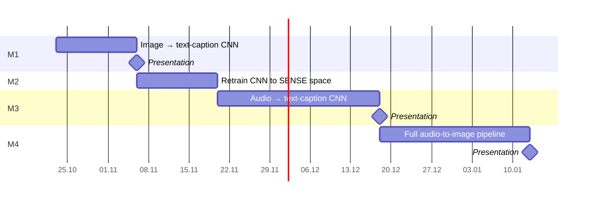

## Timeline



## Setup

```shell
python3 -m venv .venv
source .venv/bin/activate
pip install -r requirements.txt
```

## Project layout

```
data/
  {train,val}_meta.csv   one row per spoken caption: audio file, image id, caption text
  raw/                   (not in Git) wavs, COCO images and the SpokenCOCO json
  features/              (not in Git) embeddings computed from raw/
dataset/                 builds data/, run in the order below
models/                  model definitions
train/                   training: the loop, settings (config.py), data, augmentation, loss
evaluate/                evaluation of trained models: recall, confusion matrix, semantic map, examples
demo/                    caption search window
results/image_cnn/       (not in Git) the trained image CNN: model.pt, config, training log and curves, evaluation/
utils.py                 shared paths and helpers
```

## Dataset

The team's shared split of [SpokenCOCO](https://groups.csail.mit.edu/sls/downloads/placesaudio/): the first 110,000 train and 10,000 val spoken captions of the SpokenCOCO archive, as downloaded by `dataset.download_raw_dataset`. The caption text is the ground truth for both the image CNN and the audio CNN: both map their input into the same caption embedding space.

| Split | Images | Captions | Source |
|---|---|---|---|
| train | 22,047 | 110,000 | SpokenCOCO train |
| val | 2,011 | 10,000 | SpokenCOCO val, for choosing epochs and settings; all reported recall is on val |

The metadata CSVs `data/{train,val}_meta.csv` are committed and are the reference for the split; the raw files are not. On a fresh clone, download the raw files once; `dataset.generate_metadata` rebuilds the same CSVs from them. Images can sit in any folder under `data/raw/` (earlier scripts used different folders), and the scripts find them there.

## Run

All commands run from the repository root, with `source .venv/bin/activate` first.

### Data

On a fresh clone, first the raw files (SpokenCOCO archive, streamed, plus the COCO images):

```shell
python3 -m dataset.download_raw_dataset      # data/raw/{train,val}/ and the SpokenCOCO json
python3 -m dataset.generate_metadata         # only if the committed CSVs must be rebuilt
```

Then once, and again whenever the CSVs change:

```shell
python3 -m dataset.cache_images              # whole photos at 224 px: data/features/{train,val}_images_224.npy (~3.6 GB, ~2 min)
python3 -m dataset.extract_caption_features  # centred BGE-M3 caption targets: data/features/{train,val}_text.npy, caption_mean.npy (~5 min)
```

### Image CNN (image -> caption space)

Our own CNN, trained from scratch: a ResNet-18-style network with widths 80 / 160 / 320 / 640 (19.6M parameters) on 224 px images. It maps each image into the frozen, centred BGE-M3 caption space and is trained with symmetric InfoNCE and a learned temperature. Each batch holds 256 distinct images and all of their captions, about 5 per image. Trained from scratch, the network overfits quickly, so it is strongly regularized: AdamW weight decay 1.0, dropout 0.5 in the head, stochastic depth up to 0.1, and on the GPU random resized crops (25-100 % of the area), flips, colour jitter, random grayscale and random erasing. Validation uses an exponential moving average of the weights, and each image's embedding is averaged with its mirror image's. The defaults in [train/config.py](train/config.py) are the settings of the trained model in `results/image_cnn/` (best epoch 73 of 80):

| val (2,011 images, 10,000 captions) | R@1 | R@5 | R@10 |
|---|---|---|---|
| caption → image | 17.9 | 44.3 | 59.3 |
| image → caption | 21.2 | 47.3 | 60.9 |
| caption → image, improved search (extra crops + hubness correction) | 20.6 | 48.6 | 63.7 |

```shell
python3 -m train.train_image_to_caption                                       # results/image_cnn/ (~2 h for 80 epochs)
python3 -m train.train_image_to_caption --results results/image_cnn_seed1 --set seed=1
```

`--set name=value` overrides any setting in [train/config.py](train/config.py), for example `epochs`, `weight_decay`, `checkpoint` (`False`: faster, but more GPU memory) or `seed` (default 53; another seed shows how much a result varies between runs). Each run writes `model.pt`, `config.json`, `training_metrics.csv` and `training_curves.png` into its `--results` folder.

### Search images by caption

A window where you type a caption and see the 10 images the CNN ranks highest, among the 2,011 val images (never trained on) or the 22,047 train images. The caption is embedded with BGE-M3 and centred exactly like the training targets. "Random caption" picks a real caption and outlines its own image in green, or says at which rank it came. Click an image to see it large with all of its captions. Two checkboxes improve the ranking without changing the model: extra test-time crops, and hubness correction against the train captions (together +2.7 R@1).

```shell
python3 -m demo.search_images_by_caption                                      # the model in results/image_cnn/
```

### Evaluation

Separate from training: each script loads a trained model (`--model <results folder>`, default `results/image_cnn`) and writes into that folder's `evaluation/`. The search window accepts the same `--model`.

```shell
python3 -m evaluate.report                     # everything below, summary in results/evaluation_report.csv
python3 -m evaluate.recall                     # recall R@1/5/10 both ways, overfitting gap, improved search, ranks.png, words.png
python3 -m evaluate.recall --model results/image_cnn results/image_cnn_seed1
                                               # several models: also a comparison table, results/model_comparison.csv
python3 -m evaluate.confusion_matrix           # zero-shot confusion matrix over 14 concepts (dog, cat, pizza, train, …)
python3 -m evaluate.semantic_map               # x-y map (t-SNE) of the val images (o) and their captions (x), by concept (hover = image)
python3 -m evaluate.semantic_map --concepts dog cat --method pca   # only some concepts; PCA instead of t-SNE
python3 -m evaluate.examples                   # random successes and failures, hub images
```

| Script | Question it answers |
|---|---|
| `recall` | How often is the right image in the top 1 / 5 / 10? How much does the CNN overfit (train vs val)? |
| `confusion_matrix` | Does the CNN recognise the concepts in the images, and which ones does it mix up? |
| `semantic_map` | Do images and captions of the same concept land together? Which images sit in the wrong cluster? |
| `examples` | What do typical successes and failures look like? Which images come first for too many captions? |

Image embeddings are cached in each model's `cache/` folder and recomputed when its `model.pt` changes. Loading a model and its embeddings is in [evaluate/common.py](evaluate/common.py), ranks and recall in [evaluate/metrics.py](evaluate/metrics.py) (also used by training), and the concepts in [evaluate/concepts.py](evaluate/concepts.py).
