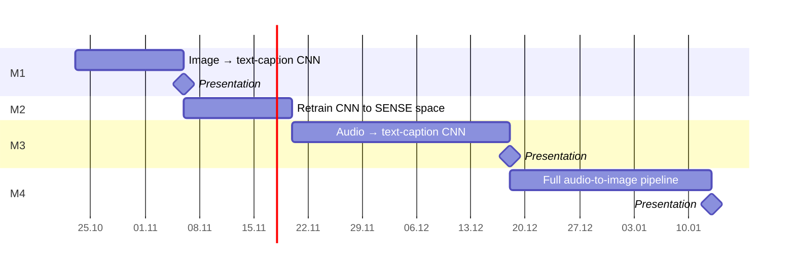

## Timeline



## Setup

```shell
python3 -m venv .venv
source .venv/bin/activate
pip install -r requirements.txt
```

## Data

The embeddings are not committed, so generate them once:

```shell
python3 download_raw_dataset.py      # ~20 GB of images and audio into data/raw/
python3 generate_metadata.py         # data/{train,val}_meta.csv
python3 extract_caption_features.py  # BGE-M3 caption embeddings: data/{train,val}_t.npy
```

## Run

```shell
source .venv/bin/activate
python3 whatever.py
```
